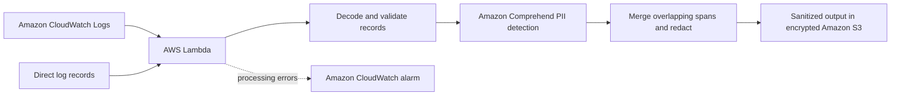

# PII Detection & Remediation Pipeline (PoC)

A personal proof of concept exploring how personally identifiable information
(PII) can be detected and redacted from log messages before those messages reach
downstream storage and observability workflows.

The solution combines **Python, AWS Lambda, Amazon Comprehend, CloudWatch Logs,
and Amazon S3**. Synthetic log records illustrate the processing flow, while
Terraform describes the supporting AWS infrastructure.

## Project objective

Reduce the exposure of sensitive information in downstream log data while
preserving the operational context needed for troubleshooting. The pipeline
identifies sensitive spans, replaces them with redaction markers, and produces
sanitized records with detection metadata.

## Solution architecture



## How the solution works

1. **Log input:** Lambda receives a batch of log records directly or through a
   CloudWatch Logs subscription.
2. **Validation:** The pipeline decodes the incoming event and checks the record
   structure and supported payload limits.
3. **PII detection:** Amazon Comprehend identifies sensitive entities and returns
   their types, character positions, and confidence scores.
4. **Remediation:** Python merges overlapping or adjacent spans and replaces the
   detected values with `[REDACTED]` markers.
5. **Sanitized output:** The pipeline produces redacted messages and metadata
   describing the findings. Original messages and detected raw values are omitted
   from the output structure.
6. **Storage:** When the S3 destination is configured, sanitized batches are
   written to an encrypted private bucket.
7. **Failure monitoring:** A CloudWatch alarm monitors Lambda errors. Detection
   or validation failures stop the batch before sanitized output is emitted.

## Illustrative redaction

Synthetic input:

```text
Customer demo@example.com called +12025550123 about a payment issue.
```

Illustrative sanitized output:

```text
Customer [REDACTED] called [REDACTED] about a payment issue.
```

Finding metadata retains the entity type, source character offsets, and detection
confidence. It excludes the detected value itself.

## Key capabilities

- Comprehend-based detection integrated with a Python Lambda handler.
- Support for direct records and CloudWatch Logs event envelopes.
- Overlapping-span redaction without duplicating sensitive text.
- Redaction of every returned detection, including low-confidence findings.
- Batch validation and failure handling that prevent partial batch output when
  detection or validation fails.
- Private S3 output with encryption and TLS enforcement in the infrastructure
  configuration.
- Infrastructure configuration for IAM permissions, log retention, storage
  retention, concurrency limits, and error monitoring.

## PoC scope

Synthetic messages provide the demonstration data. The main AWS workflow uses
Amazon Comprehend; a separate offline regex demonstration supports local
inspection of the redaction logic.

Redaction depends on the entities detected. Processing a CloudWatch log stream
creates sanitized downstream records; it does not alter the original source
logs. Automated remediation in this project means text redaction, not changes to
applications, customer records, or source systems.

## Technology stack

| Component | Role |
|---|---|
| Python | Input validation, span handling, and redaction |
| AWS Lambda | Event-driven log processing |
| Amazon Comprehend | PII entity detection |
| Amazon CloudWatch Logs | Log-event source and function logging |
| Amazon S3 | Encrypted storage of sanitized output |
| AWS IAM | Scoped access to the processing resources |
| Amazon CloudWatch alarms | Processing-error monitoring |
| Terraform | AWS infrastructure configuration |

## Repository references

- [Architecture and workflow](docs/architecture.md): processing sequence and component responsibilities.
- [Development reference](docs/development.md): local validation and AWS deployment details.
- `src/pii_detector.py`: Comprehend integration and span redaction.
- `src/lambda_handler.py`: event processing and sanitized output handling.
- `terraform/`: AWS infrastructure configuration.

## Validation

Automated tests cover redaction, overlapping spans, Unicode offsets, CloudWatch
events, AWS SDK request contracts, failure handling, and sanitized S3 output.
CI also checks dependencies, validates Terraform, and builds the Lambda package.
