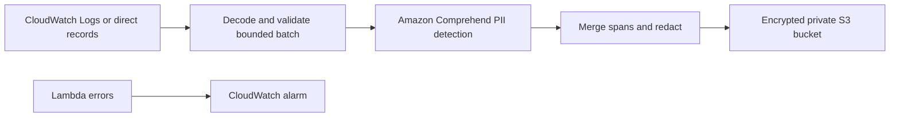

# PII Comprehend Remediation Pipeline

Detect sensitive spans with **Amazon Comprehend DetectPiiEntities** and redact
logs before writing sanitized batches to S3. Python handles validation and
redaction; AWS Lambda processes direct records or CloudWatch Logs subscriptions;
Terraform defines the AWS resources. An explicit regex backend supports offline
demonstrations using synthetic data only.

## Architecture



Original messages and detected raw values are never returned, written to the
sanitized destination, or intentionally logged. Findings contain only type,
character offsets, and confidence. All detections are redacted, including
low-confidence ones. Overlapping spans are merged before masking.

## Offline demo and tests

Use Python 3.13 or 3.14:

```sh
python -m venv .venv
# Windows PowerShell: .venv\Scripts\Activate.ps1
# macOS/Linux: source .venv/bin/activate
python -m pip install -r requirements-dev.lock
python -m src.local_run
python -m unittest discover -s tests -v
```

The demo calls the regex detector directly and makes no AWS requests. Regex
patterns are limited demonstrations and can miss PII or over-redact numbers.
They are **not** a Comprehend replacement or a detection-accuracy benchmark.

## Handler contract

Handler: `src.lambda_handler.lambda_handler`.

Direct input:

```json
{"records":[{"message":"Synthetic email demo@example.com"}]}
```

The handler also accepts the standard CloudWatch `awslogs.data` base64/gzip
envelope and ignores control messages. It accepts up to 1,000 records, each
limited to 100,000 UTF-8 bytes. The compressed-envelope limit is 2 MB, and expanded
CloudWatch JSON is capped at 4 MB. Unsupported or oversized batches fail rather
than forwarding unchecked content. Additional record metadata is dropped.

Processing is batch-atomic before output: any detection or validation failure
raises a generic error and no partial sanitized batch is emitted. There is no
fallback from a failed Comprehend call to regex. Downstream S3 failures also fail
the invocation so the event source can apply its retry behavior.

| Variable | Default | Purpose |
|---|---|---|
| `PII_BACKEND` | `comprehend` | `regex` allowed only outside production |
| `ENVIRONMENT` | `production` | Prevents accidental production regex use |
| `PII_LANGUAGE` | `en` | `en` or `es` |
| `SANITIZED_BUCKET` | unset | Write sanitized JSON to S3; otherwise return sanitized records |
| `AWS_REGION` | AWS runtime configuration | Comprehend/S3 client region |

CloudWatch delivery is at least once; repeated deliveries may create duplicate
sanitized S3 objects. S3 keys use random IDs and contain no record content. Each
batch performs one Comprehend request per nonempty record, sequentially, with
bounded SDK retries and connection/read timeouts. Size batches and Lambda timeout
for measured throughput and account quotas. This implementation has not been
load-tested against AWS; review large subscription batches before deployment.

## Terraform deployment

The deployment package targets **Lambda Python 3.13 x86_64**, including Linux
wheels even when built from Windows. Building needs network access to PyPI.

```sh
python scripts/package_lambda.py
terraform -chdir=terraform init
terraform -chdir=terraform validate
terraform -chdir=terraform plan -var='source_log_group_name=/your/existing/source'
# Review the plan before applying in your AWS account.
```

Terraform provisions a Lambda execution role, scoped log-write and S3-write IAM
permissions, Comprehend detection permission, private S3 storage with encryption
and TLS enforcement, a 30-day object expiry policy, a 14-day Lambda log retention
policy, concurrency limits, and a Lambda error alarm. Optional existing SNS topic
ARNs can receive alarm actions. A source subscription is created only when
`source_log_group_name` is supplied. The source must not be the processing
Lambda's own log group, which would create a recursive subscription.

`comprehend:DetectPiiEntities` requires `Resource: "*"` because that action does
not support resource-level restrictions; other permissions are scoped. The
bucket is not force-deleted. Use an encrypted, access-controlled remote Terraform
state backend for real deployments. No AWS resources are deployed by CI.

## Privacy boundary and limitations

Comprehend receives the original text inside your configured AWS region.
Redaction is detection-dependent and cannot guarantee that every sensitive value
is found. Source CloudWatch logs already contain the original messages; this
pipeline does not erase or sanitize that source. Restrict source access and
retention. Review downstream consumers and never enable payload debug logging.

No raw-event dead-letter destination is configured because it would retain PII.
CloudWatch retries and retention are finite; this project does not promise
lossless delivery. Error alarms require an operator response and a documented
recovery procedure. Synthetic tests verify span handling and the SDK request
contract; production detection accuracy and AWS throughput remain unmeasured.

References: [Comprehend API limits](https://docs.aws.amazon.com/comprehend/latest/APIReference/API_DetectPiiEntities.html),
[PII analysis](https://docs.aws.amazon.com/comprehend/latest/dg/realtime-pii-api.html).
