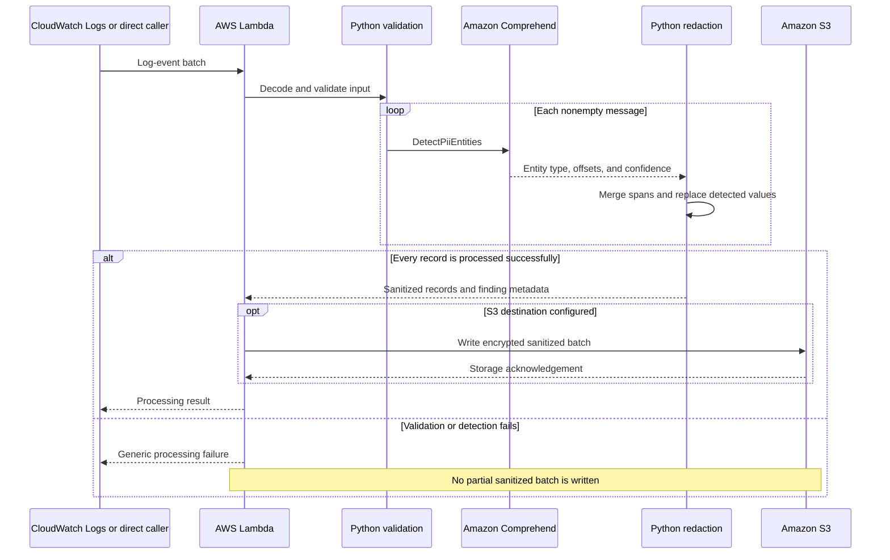

# PII remediation architecture

The PoC separates log ingestion, PII detection, redaction, and sanitized storage.
Synthetic records illustrate this flow without requiring organizational log data.

## Processing sequence

The diagram represents the processing contract. A CloudWatch subscription does
not consume the Lambda response as a downstream log destination; the configured
S3 sink stores the sanitized output.

## Component responsibilities

| Component | Responsibility |
|---|---|
| CloudWatch Logs | Supplies encoded log-event batches |
| Lambda | Coordinates validation, detection, redaction, and optional storage |
| Comprehend | Returns sensitive-entity findings for supported text |
| Python redaction | Merges overlapping or adjacent spans and inserts redaction markers |
| S3 | Stores sanitized batch content with server-side encryption |
| IAM | Restricts the function's access to required services and destinations |
| CloudWatch alarm | Monitors Lambda errors and supports configured notification actions |
| Terraform | Defines the function, permissions, storage controls, and monitoring |

## Data handling

- Input messages are sent to Comprehend in the configured AWS region.
- Output records contain sanitized text and entity metadata, not an additional
  copy of the original message or a raw-value findings field.
- Character offsets describe positions in the original input, not the shortened
  sanitized message.
- Every returned finding is redacted. Lower detection confidence does not cause
  the pipeline to preserve a detected value.
- Redaction is detection-dependent; an undetected entity may remain in the text.
- CloudWatch source records remain subject to their own retention and access
  controls. The pipeline produces a sanitized downstream copy.

## Failure behavior

Validation and detection complete for the entire batch before output is written.
A failed Comprehend call does not silently fall back to regex. Errors returned by
processing are generic and omit sensitive input and provider details. A failed
S3 write fails the invocation so event-source retry behavior can apply.

CloudWatch delivery can repeat events, so duplicate sanitized objects are
possible. Error alarms and retry behavior support investigation, but the PoC does
not implement a durable recovery queue. Further technical details are in the
[development reference](development.md).
